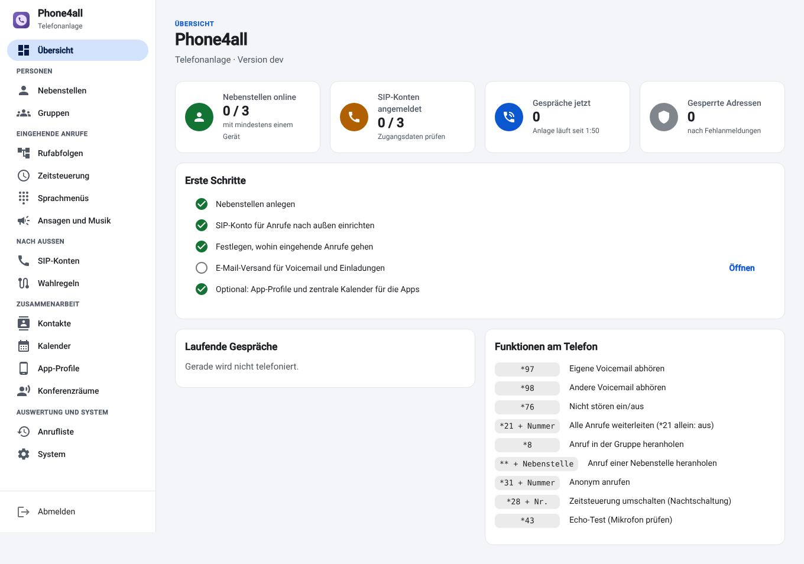
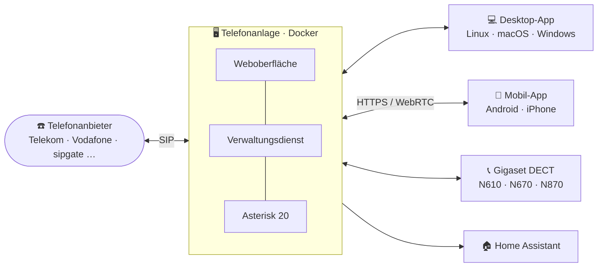
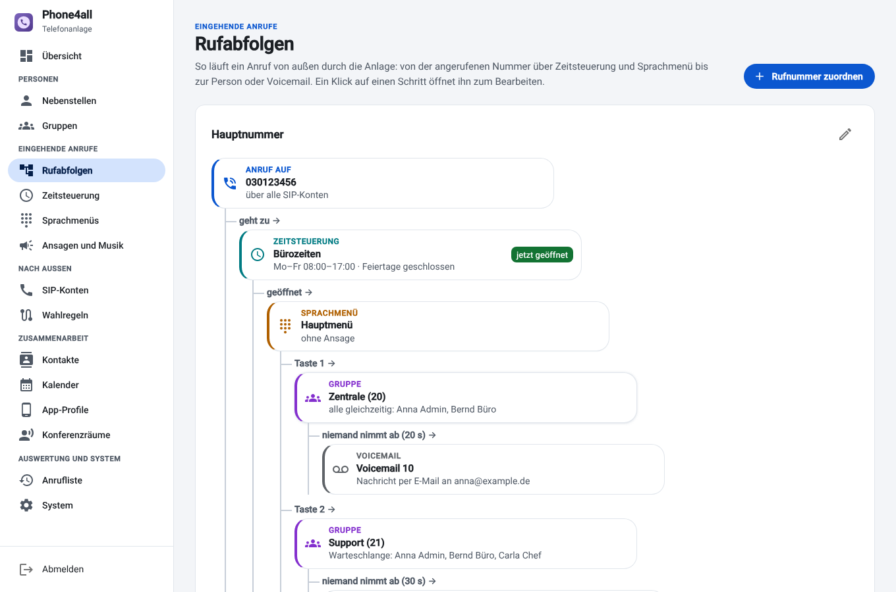
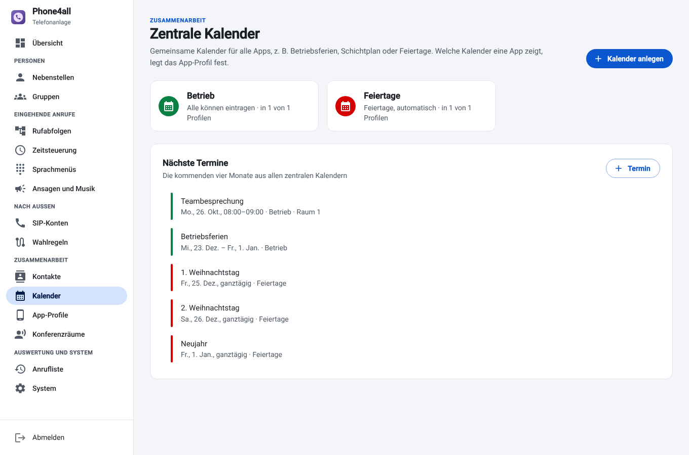

<div align="center">


# Phone4all

**Moderne Telefonanlage, die einfach bleibt.**

Telefonanlage im Docker-Container · Desktop-App für Linux, macOS und Windows ·
Mobil-App für Android und iPhone · DECT · Home Assistant

[](https://github.com/henne-407/phone4all/actions/workflows/build.yml)
[](https://github.com/henne-407/phone4all/actions/workflows/pbx.yml)
[](https://github.com/henne-407/phone4all/actions/workflows/homeassistant.yml)
[](https://github.com/henne-407/phone4all/releases)
[](LICENSE)

[**Schnellstart**](#-schnellstart) · [**Funktionen**](#-funktionen) ·
[**Dokumentation**](#-dokumentation) · [**Downloads**](https://github.com/henne-407/phone4all/releases)

<br>



</div>

<br>

## 🧩 Ein System, alle Geräte

Die Telefonanlage ist das Herz von Phone4all. Sie verteilt Konten, Telefonbuch, Kalender
und App-Profile an alle Geräte. Neue Telefone richten sich selbst ein: Nebenstelle und PIN
eingeben, QR-Code scannen oder eine Provisioning-Adresse eintragen, fertig.



<table>
<tr>
<td width="50%" valign="top">

### 🖥️ Telefonanlage

Asterisk 20 mit deutscher Weboberfläche, als ein Docker-Image für Server, VM, NAS
(z. B. TrueNAS) und Raspberry Pi. Updates per Klick.

[Bedienung](docs/telefonanlage.md) · [Installation](docs/installation.md) · [Referenz](pbx/README.md)

</td>
<td width="50%" valign="top">

### 💻 Desktop-App

Softphone mit Anruf-Pop-up, Kontakten, Kalender, Verlauf und Messenger. Läuft auch mit FRITZ!Box,
3CX, Starface oder sipgate.

[Anleitung](docs/desktop-app.md) · [Download](https://github.com/henne-407/phone4all/releases/latest) ·
[Im Browser](docs/web-client.md)

</td>
</tr>
<tr>
<td valign="top">

### 📱 Mobil-App

Die eigene Nebenstelle auf dem Handy, im Büro und unterwegs über eine HTTPS-Adresse
(z. B. hinter Pangolin).

[Anleitung](docs/mobil-app.md) · [Fernzugriff](docs/fernzugriff.md)

</td>
<td valign="top">

### 📞 DECT- und Tischtelefone

Gigaset N610/N670/N870 IP PRO sowie Yealink- und Snom-Tischtelefone richten sich per
Auto-Provisioning selbst ein, mit Telefonbuch per LDAP und Funktionstasten.

[Anleitung](docs/dect.md)

</td>
</tr>
<tr>
<td colspan="2" valign="top">

### 🏠 Home Assistant

Verpasste Anrufe, Notrufe, Türklingel, abgemeldete SIP-Konten und Störungen als Sensoren und
Ereignisse; *Nicht stören* und Zeitsteuerungen schalten, Ansagen und Anrufe auslösen. Mit
fertigem Blueprint für Benachrichtigungen aufs Handy. Installation über HACS.

[Anleitung](docs/home-assistant.md)

</td>
</tr>
</table>

## 🚀 Schnellstart

**1. Anlage installieren** auf einem Debian- oder Ubuntu-Server:

```sh
curl -fsSL https://raw.githubusercontent.com/henne-407/phone4all/main/pbx/install.sh | sudo sh
```

Am Ende stehen Adresse und erstes Passwort der Weboberfläche da (`http://<server>:8080`,
Benutzer `admin`). Docker Compose, TrueNAS, Proxmox und Raspberry Pi:
[Installation](docs/installation.md).

**2. Einrichten.** Die Übersicht führt mit *Erste Schritte* durch Nebenstellen, das
SIP-Konto beim Anbieter und die Rufabfolge für eingehende Anrufe.

**3. Telefone verbinden.** Die [Desktop-App](https://github.com/henne-407/phone4all/releases/latest)
findet die Anlage im Netz, Handys scannen den QR-Code der Nebenstelle, Gigaset-Basen
holen sich ihre Einrichtung selbst.

➡️ Ausführlich: [Erste Schritte](docs/erste-schritte.md)

## ✨ Funktionen

<table>
<tr>
<td width="50%" valign="top">

**Anrufe steuern**
- Nebenstellen mit mehreren Geräten gleichzeitig
- Gruppen: alle gleichzeitig, nacheinander, Warteschlange
- Rufabfolgen als Diagramm, per Drag & Drop bearbeitbar
- Zeitsteuerung mit Feiertagen je Bundesland
- Sprachmenüs, Ansagen im Browser aufnehmen oder aus Text sprechen
- Voicemail per E-Mail und in den Apps, auch als Text; Konferenzräume, Aufzeichnung
- Rückfrage, Makeln und Dreierkonferenz in den Apps
- Handy klingelt mit, Gruppen an- und abmelden, Status aus dem Kalender
- Durchsage und Gegensprechen
- Anrufsperren, Gespräche parken, Besetztanzeige
- Chef und Sekretariat, Rückruf bei besetzt und statt Warteschleife
- Erinnerungsanrufe, Mithören und Aufschalten, Klingelton je Herkunft
- KI-Telefonassistent und Gesprächszusammenfassungen (eigenes oder externes Sprachmodell)

</td>
<td width="50%" valign="top">

**Anbinden und zusammenarbeiten**
- Vorlagen für Telekom, Vodafone, Deutsche Glasfaser, 1&1, o2, sipgate, easybell, Placetel, FRITZ!Box
- Wahlregeln mit Ausweichkonto
- Zentrales Telefonbuch, auch per LDAP; Kontakte und Kalender aus Microsoft 365 und Google
- Zentrale Kalender für alle Apps
- Messenger: Einzel- und Gruppenchats mit Dateien, Videoanrufen und Bildschirm teilen
- SMS senden und empfangen (sipgate oder eigener Anbieter)
- App-Profile: was die Apps zeigen, CRM beim Anruf öffnen
- Verpasste Gruppenanrufe gemeinsam abarbeiten
- Fax per E-Mail, ohne Faxgerät
- Webhooks und Anrufe über die Schnittstelle

</td>
</tr>
<tr>
<td valign="top">

**Betrieb**
- Watchdog mit Selbstheilung und Diagnose
- Online-Updates, stabil oder Beta
- Tägliche Sicherung, auch verschlüsselt auf WebDAV oder S3
- Auswertungen: wann wer anruft und wie viele niemand annimmt
- Mehrere Zugänge mit Rollen, Selbstbedienung für alle
- Benachrichtigung bei Notrufen
- Wallboard für Warteschlangen, Messwerte für Prometheus, Syslog
- Sperre nach Fehlanmeldungen, TLS/SRTP

</td>
<td valign="top">

**Unterwegs und zu Hause**
- Fernzugriff nur über HTTPS, eingebauter TURN-Server
- Einrichtung per QR-Code oder Einladungs-E-Mail
- Home Assistant mit Sensoren, Ereignissen, Blueprint

</td>
</tr>
</table>

## 📸 Einblicke

<table>
<tr>
<td width="50%"></td>
<td width="50%"></td>
</tr>
<tr>
<td align="center"><sub>Rufabfolgen: der Weg eines Anrufs als Diagramm</sub></td>
<td align="center"><sub>Zentrale Kalender für alle Apps</sub></td>
</tr>
<tr>
<td></td>
<td></td>
</tr>
<tr>
<td align="center"><sub>Desktop-App, helles Design</sub></td>
<td align="center"><sub>Desktop-App, dunkles Design</sub></td>
</tr>
</table>

## 📚 Dokumentation

| | Thema | Inhalt |
| :---: | --- | --- |
| 🏁 | [Erste Schritte](docs/erste-schritte.md) | vom leeren Server zum ersten Anruf |
| 📦 | [Installation](docs/installation.md) | Docker, TrueNAS, VM, Raspberry Pi, Ports, Updates, Umzug |
| 🖥️ | [Telefonanlage bedienen](docs/telefonanlage.md) | die Weboberfläche Seite für Seite, Funktionscodes |
| 💻 | [Desktop-App](docs/desktop-app.md) | Installation, Einrichtung, Kalender, Adressbücher |
| 📱 | [Mobil-App](docs/mobil-app.md) | Android und iPhone |
| 🌍 | [Zugriff von unterwegs](docs/fernzugriff.md) | HTTPS mit Pangolin oder einem anderen Reverse-Proxy |
| 📞 | [DECT-Telefone](docs/dect.md) | Gigaset N610 IP PRO Schritt für Schritt |
| 🏠 | [Home Assistant](docs/home-assistant.md) | Integration, Blueprint, Beispiele |
| 🩺 | [Fehlersuche](docs/fehlersuche.md) | häufige Probleme und ihre Lösung |
| 🛠️ | [Entwicklung](docs/entwicklung.md) | Aufbau, Tests, CI, Releases |
| 📖 | [Referenz der Anlage](pbx/README.md) | Ports, Schnittstellen, Datenablage |

## 📥 Downloads und Versionen

Jeder Teil hat eigene Versionen. Alles steht unter
[Releases](https://github.com/henne-407/phone4all/releases).

| Teil | Tag | Pakete |
| --- | --- | --- |
| 💻 Desktop-App | `v…` | `.rpm` · `.deb` · `.AppImage` · `.dmg` · `.exe` |
| 🖥️ Telefonanlage | `pbx-v…` | Docker-Image `ghcr.io/henne-407/phone4all-pbx` (amd64, arm64) |
| 📱 Mobil-App | `mobile-v…` | `.apk` für Android, unsignierte `.ipa` für iPhone |
| 🏠 Home Assistant | – | über HACS direkt aus diesem Repository |

## 🤝 Mitmachen

Fehler und Wünsche bitte als [Issue](https://github.com/henne-407/phone4all/issues/new/choose)
melden. Aufbau, Tests und Code-Stil stehen unter [Entwicklung](docs/entwicklung.md).

## 📄 Lizenz

[MIT](LICENSE). Phone4all nutzt unter anderem [Asterisk](https://www.asterisk.org)
(GPLv2, im Docker-Image), [baresip](https://github.com/baresip/baresip),
[JsSIP](https://jssip.net), [Electron](https://www.electronjs.org),
[React](https://react.dev) und [Material UI](https://mui.com).
