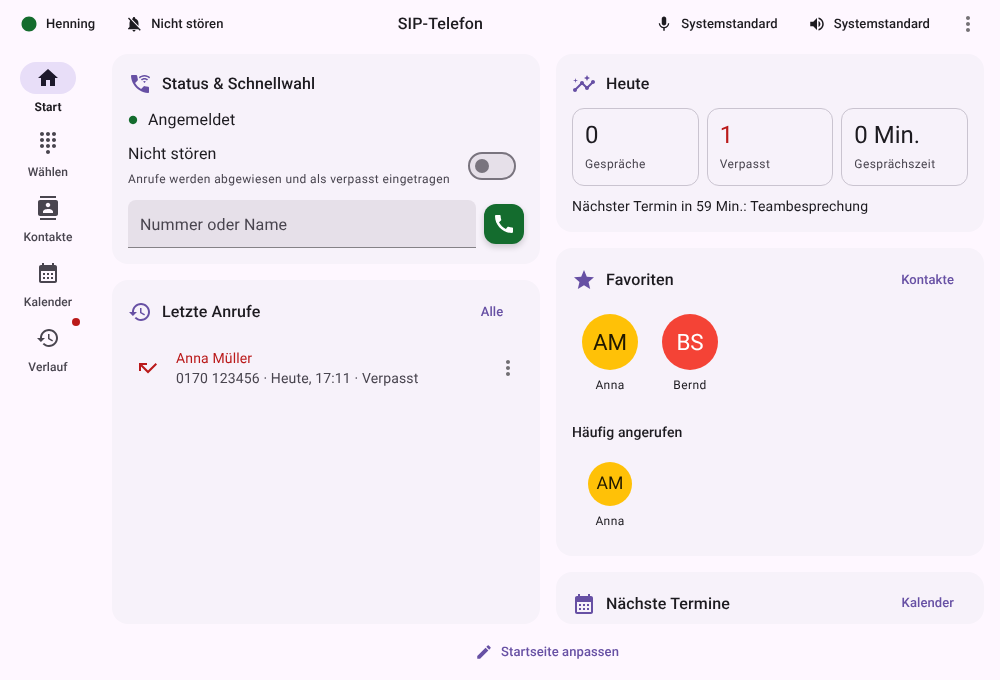
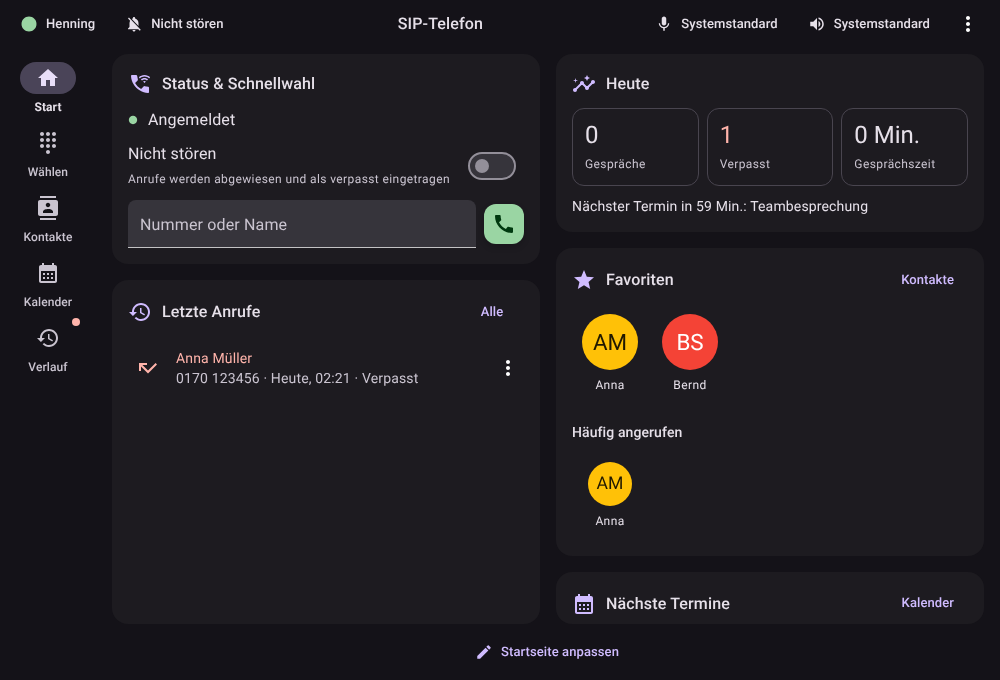
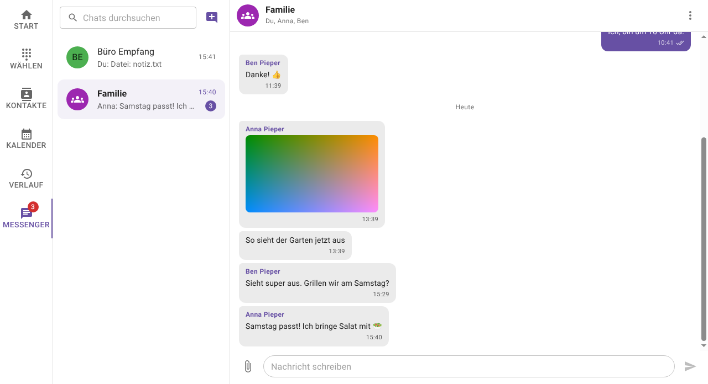

# Desktop-App Phone4All

Schlanker SIP-Softphone-Client für **Linux, macOS und Windows** mit einer Oberfläche
in Material UI. Verbindet sich mit einer SIP-Telefonanlage (z. B. FRITZ!Box, Asterisk,
3CX, Starface, Sipgate), wählt Nummern, verwaltet Kontakte, meldet eingehende Anrufe
per Pop-up und Benachrichtigung und zeigt deinen Kalender (CalDAV, unter Linux auch
GNOME Online-Konten) inklusive Einwahlnummern zum direkten Anrufen.

Die SIP- und Audio-Arbeit macht [baresip](https://github.com/baresip/baresip), das als
Hintergrundprozess gestartet und über sein `ctrl_tcp`-Modul gesteuert wird. Die App
selbst ist mit Electron, React und [Material UI](https://mui.com/) gebaut.

<p align="center">
  
  
</p>

## Installation

Fertige Pakete stehen unter [Releases](https://github.com/henne-407/phone4all/releases/latest)
(Tags `v*`). GitHub Actions baut außerdem bei jedem Push Testpakete (Artefakte):

| System | Paket | baresip |
| --- | --- | --- |
| Linux | `.rpm`, `.deb`, `.AppImage` | aus der Distribution (siehe unten) |
| macOS | `.dmg` (Apple Silicon und Intel) | mitgeliefert |
| Windows | `.exe`-Installer (x64) | mitgeliefert |

**Linux** – baresip installieren:

```sh
sudo dnf install baresip baresip-pipewire baresip-opus baresip-g722   # Fedora
sudo apt install baresip                                               # Debian/Ubuntu
```

Ohne Paket direkt aus dem Quellcode für den eigenen Benutzer installieren
(ersetzt auch den Startmenü-Eintrag der früheren GTK-Version):

```sh
scripts/install-linux.sh
```

**macOS** – die App ist nur ad-hoc signiert, nicht von Apple notarisiert. Beim ersten
Start meldet macOS, dass der Entwickler nicht überprüft werden kann. Dann unter
*Systemeinstellungen → Datenschutz & Sicherheit* ganz unten *Dennoch öffnen* wählen
(bis macOS 14 genügt im Finder Rechtsklick → *Öffnen*). Alternativ im Terminal:
`xattr -dr com.apple.quarantine /Applications/Phone4All.app`.
Beim ersten Anruf fragt macOS nach dem Mikrofon.

**Windows** – Installer starten; Windows SmartScreen warnt, weil der Installer
nicht signiert ist (*Weitere Informationen* → *Trotzdem ausführen*).

**Updates** – die App sucht alle sechs Stunden nach einem neuen Release
(*Einstellungen → Allgemein → Aktualisierung*, dort auch *Nach Updates suchen*).
Ist eine neue Version da, erscheint oben ein Update-Symbol. Mit *Automatisch
aktualisieren* lädt sie die Version selbst und spielt sie ein, sobald das Fenster
geschlossen ist und kein Gespräch läuft. Das klappt mit AppImage, `.rpm`/`.deb`
(fragt per pkexec nach dem Passwort), der Installation aus `scripts/install-linux.sh`
(lädt das `.tar.gz`), macOS und Windows.

## Einrichtung

Menü (⋮) → **Einstellungen** → **Konto**: Server/Domain, Benutzername und Passwort
eintragen. Beim Schließen des Dialogs verbindet sich das Programm neu. Der Punkt
links in der Titelleiste zeigt den Status (grün = angemeldet).

FRITZ!Box: unter *Telefonie → Telefoniegeräte → Neues Gerät → Telefon (LAN/WLAN)*
ein IP-Telefon anlegen. Server ist `fritz.box`, Benutzername der dort vergebene
Name (z. B. `620`).

Mit der [Phone4all-Telefonanlage](telefonanlage.md) geht es ohne Abtippen: unter
**Konto** → **Einrichten** findet die App die Anlage im Netzwerk; Nebenstelle und
Einrichtungs-PIN genügen. Alternativ den Link aus der Einladungs-E-Mail öffnen
(`sip-telefon://…`). Änderungen an der Anlage und ihr Telefonbuch übernimmt die App
danach automatisch.

Hängt an der Nebenstelle ein **App-Profil**, bestimmt die Anlage, welche Bereiche die App
in welcher Reihenfolge zeigt, mit welcher Ansicht sie startet, welche Karten auf der
Startseite liegen und welche zentralen Kalender erscheinen. Gesperrte Startseite oder
Kontodaten lassen sich in der App dann nicht ändern. Die App fragt alle zwei Minuten
nach Änderungen (siehe [App-Profile](telefonanlage.md#app-profile)).

## Funktionen

- Anrufe komplett im kleinen Pop-up-Fenster führen, ohne das Hauptfenster zu öffnen:
  annehmen/ablehnen, „Stumm klingeln“, stummschalten, halten, Tastentöne, weiterleiten,
  auflegen (abschaltbar unter Einstellungen → Allgemein)
- Weiterleiten (Blind Transfer) auch direkt beim Klingeln, mit Kontaktvorschlägen
- Material-Design mit Farbthemen (Violett, Blau, Türkis, Grün, Senf, Orange, Koralle,
  Pink, Graphit oder die Akzentfarbe des Systems) und Hell/Dunkel/System,
  Kontrast nach WCAG AA geprüft
- Navigation unten im schmalen Fenster, als Navigationsleiste links im breiten Fenster;
  Seiten nutzen breite Fenster mit Detailansichten und Seitenleisten
- Klingeltöne: Marimba (Standard), Glocken, Klassisch, Dezent, baresip-Original oder eine
  eigene Audiodatei (WAV/MP3/OGG …), mit Probehören; ausgehend deutsches Freizeichen
- Titelleiste mit Anmeldestatus (neu anmelden, ab-/anmelden, Konto), „Nicht stören“,
  Mikrofon mit Pegelanzeige, Lautsprecher mit Testton und separates Gerät zum Klingeln –
  Umschalten wirkt sofort, auch im laufenden Gespräch
- Rufumleitung (mit Phone4All-Telefonanlage): in der Titelleiste auf eine Nebenstelle,
  Gruppe oder Nummer umleiten; unter *Regeln und Weiterleitungen* Ziele bei besetzt / ohne
  Antwort und Regeln nach Zeitplan, Zeitsteuerung oder „Nicht stören“. Was erlaubt ist,
  legt die Anlage fest (Rechte unter *System → Zugang* und je Gruppe)
- Mit dem Recht *Telefonbuch bearbeiten* ändert und löscht die App Einträge im Telefonbuch
  der Anlage und legt neue an (*Im Telefonbuch von „…“ speichern*)
- Anpassbare Startseite (Karten in bis zu drei Spalten): Status mit „Nicht stören“ und
  Schnellwahl, Favoriten, letzte Anrufe, nächste Termine – ein-/ausblenden, sortieren,
  Startansicht wählbar
- Wähltastatur mit Tastatureingabe, Kontaktvorschlägen und Wahlwiederholung
  (Anruftaste bei leerem Feld holt die letzte Nummer)
- Kontakte (Name, Telefon, Mobil, weitere Nummern, Firma) mit Suche; Anrufer werden erkannt
- Kontakt-Import aus vCard (.vcf) und CSV (Google, iCloud, Outlook, Thunderbird, Android),
  auch per Drag & Drop auf die Kontaktliste; Dubletten werden ergänzt statt doppelt angelegt
- Adressbücher per CardDAV, aus Microsoft-SQL-Server-Datenbanken (z. B. CRM/Warenwirtschaft)
  und unter Linux aus GNOME Online-Konten – alle 30 Minuten abgeglichen (nur lesend)
- Pop-up-Fenster und Benachrichtigung bei Anrufen, Benachrichtigung bei verpassten Anrufen
- Anrufverlauf (ein-/ausgehend/verpasst) mit Statistik, Nummern direkt als Kontakt speichern
- Kalender: Monatsansicht mit Terminpunkten, Termine anlegen/ändern/löschen,
  Telefonnummern in Terminen (z. B. Einwahlnummern) per Klick anrufen
- „Rückruf planen“ aus dem Verlauf und während des Gesprächs
- Erinnerung vor Terminen als Benachrichtigung
- Läuft beim Schließen im Hintergrund weiter (Symbol im Infobereich), optionaler Autostart
- Watchdog im Hintergrund: meldet bei Abbruch neu an, startet eine abgestürzte oder hängende
  SIP-Engine neu und verbindet nach Netzwechsel oder Ruhezustand neu (nie während eines
  Gesprächs); Zustand und Ereignisse unter Einstellungen → **Diagnose**
- Passwörter verschlüsselt mit dem Schlüsselbund des Systems (macOS-Schlüsselbund,
  Windows DPAPI, GNOME-Schlüsselbund/KWallet); Passwörter der GTK-Version werden übernommen

## Messenger



Ist die App über eine Phone4all-Telefonanlage eingerichtet und dort der Messenger
eingeschaltet, erscheint links der Bereich **Messenger**:

- Einzelchats mit jeder Nebenstelle und Gruppen mit Namen und Mitgliedern
  (Knopf oben neben der Suche)
- Text, Bilder und Dateien: Büroklammer, Drag & Drop ins Fenster oder Bildschirmfoto
  mit Strg+V einfügen; Bilder erscheinen als Vorschau, andere Dateien öffnen oder speichern
- Haken für zugestellt, Doppelhaken für gelesen, Anzeige „schreibt …“ und wer gerade online ist
- Zahl ungelesener Nachrichten am Navigationssymbol, Benachrichtigung bei neuen Nachrichten
  (nicht für den Chat, der gerade offen ist)
- Telefonhörer im Einzelchat ruft die Nebenstelle an

Die Nachrichten liegen auf der Anlage, die App lädt den Verlauf beim Öffnen. Unterwegs
funktioniert der Messenger über dieselbe HTTPS-Adresse wie die Einrichtung (siehe
[Fernzugriff](fernzugriff.md)). Videoanrufe folgen in einer späteren Version.

## Kalender

Einstellungen → **Kalender**:

- **CalDAV**: „+“ bei *CalDAV-Konten*, Server-URL, Benutzer und Passwort eintragen.
  Die Kalender werden automatisch gefunden. Beispiele: Nextcloud
  `https://cloud.example.de/remote.php/dav`, iCloud `https://caldav.icloud.com`
  (app-spezifisches Passwort), mailbox.org `https://dav.mailbox.org`.
- **GNOME Online-Konten** (nur Linux; Google, Microsoft 365, …): Konto in den
  GNOME-Einstellungen unter *Online-Konten* einrichten; die Kalender erscheinen
  dann automatisch (über den Evolution Data Server, angebunden mit dem System-Python).

Serientermine werden angezeigt, lassen sich aber nur in der Kalender-App des
Anbieters bearbeiten.

## SQL-Server-Datenbank anbinden

Einstellungen → **Kontakte** → *SQL-Server-Datenbanken* → „+“. Server, Port,
Datenbank und Zugangsdaten eintragen (SQL-Login oder `DOMÄNE\benutzer`),
**Verbinden**, Tabelle oder Sicht wählen – Name-, Firma- und Telefonspalten werden
anhand der Spaltennamen vorgeschlagen. Alternativ eine eigene `SELECT`-Abfrage mit
Spalten wie `name`, `company`, `phone`, `mobile`. Es wird nur gelesen; am besten einen
Datenbankbenutzer mit reinen Leserechten (`db_datareader`) verwenden. Höchstens
50 000 Zeilen pro Quelle. Kein Treiber nötig (reines JavaScript, `tedious`).

## Dateien

| Linux | macOS / Windows | Inhalt |
| --- | --- | --- |
| `~/.config/sip-telefon/settings.json` | App-Datenordner¹ `settings.json` | Einstellungen |
| `~/.config/sip-telefon/secrets.json` | `secrets.json` | Passwörter (verschlüsselt) |
| `~/.local/share/sip-telefon/` | `data/` | Kontakte, Verlauf, Adressbuch-Cache, Klingeltöne |
| `~/.local/state/sip-telefon/baresip.log` | `logs/baresip.log` | Log der SIP-Engine |
| `~/.local/state/sip-telefon/watchdog.json` | `logs/watchdog.json` | Ereignisse des Watchdogs |

¹ macOS `~/Library/Application Support/SIP-Telefon` (Ordnername von früher), Windows `%APPDATA%\SIP-Telefon`.
Unter Linux sind es dieselben Ordner wie bei der früheren GTK-Version, Kontakte,
Verlauf und Einstellungen werden also übernommen.

## Entwicklung

Mehr zum Aufbau des ganzen Repositorys unter [Entwicklung](entwicklung.md).


```sh
npm install
npm run dev          # App mit Hot-Reload starten
npm run typecheck
npm test
npm run dist:linux   # Pakete nach dist/
```

Aufbau:

- `src/main/` – Hauptprozess (Node): baresip-Steuerung, Anruflogik, Kontakte,
  CalDAV/CardDAV, SQL Server, Fenster, Tray, Benachrichtigungen
- `src/renderer/` – Oberfläche (React + Material UI)
- `src/shared/` – gemeinsamer Code (Rufnummern, Formate, Statistik, Farbthemen)
- `resources/linux/eds_helper.py` – Zugriff auf GNOME Online-Konten (Linux)
- `scripts/build-engine.sh` – baut baresip + PortAudio-Geräteliste für macOS/Windows
- `native/pa-devices.c` – listet PortAudio-Geräte für die Geräteauswahl

Bildschirmfotos ohne sichtbares Fenster (z. B. für Tests):
`SIP_TELEFON_SCREENSHOT=/tmp/shots npm start`.

## Hinweise

- Audio: Mikrofon, Lautsprecher und Klingel-Gerät in der Titelleiste wählen
  (Standard = Systemstandard). Ein neues Klingel-Gerät wird nach dem aktuellen
  Gespräch übernommen (dafür meldet sich die App kurz neu an).
- Unter macOS/Windows nutzt baresip PortAudio (Opus, G.722, G.711).
- Passwörter mit `;` werden von baresip nicht unterstützt.
- Ist die Anlage nur über NAT erreichbar, in den erweiterten Einstellungen einen
  STUN-Server und ggf. einen festen lokalen SIP-Port eintragen.
