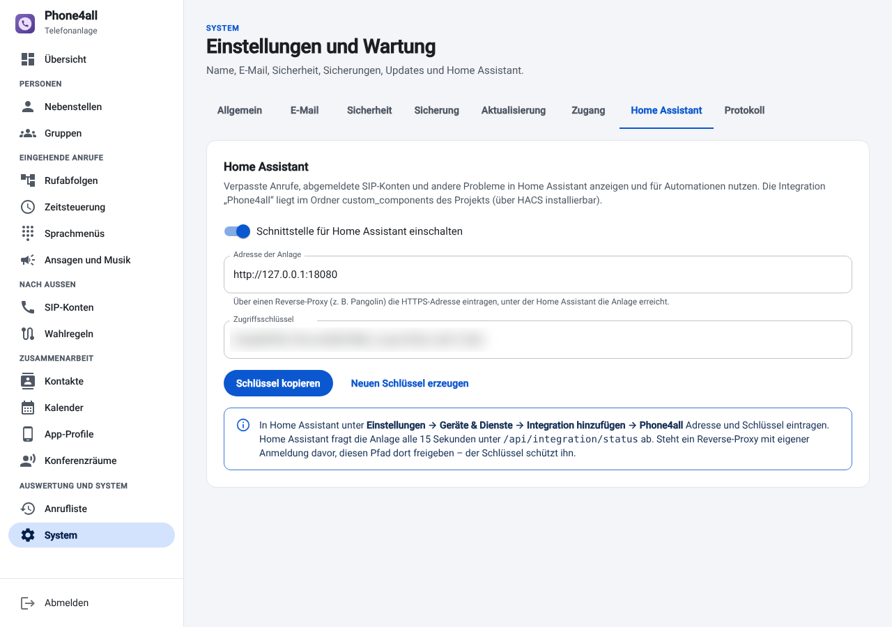

# Home Assistant

Die Integration *Phone4all-Telefonanlage* bringt verpasste Anrufe und Störungen der
Anlage nach Home Assistant: als Sensoren fürs Dashboard, als Ereignisse für Automationen
und mit einem fertigen Blueprint als Benachrichtigung aufs Handy.



## Installation

1. **Anlage:** *System → Home Assistant* → *Schnittstelle für Home Assistant einschalten*,
   Zugriffsschlüssel kopieren.
2. **HACS:** *HACS → ⋮ → Benutzerdefinierte Repositories* →
   `https://github.com/henne-407/phone4all`, Typ *Integration* → *Phone4all-Telefonanlage*
   herunterladen → Home Assistant neu starten.
   Ohne HACS: den Ordner [`custom_components/phone4all`](../custom_components/phone4all)
   nach `config/custom_components/` kopieren und neu starten.
3. *Einstellungen → Geräte & Dienste → Integration hinzufügen → Phone4all*: Adresse der
   Anlage (`http://<anlage>:8080` oder die HTTPS-Adresse) und Zugriffsschlüssel.

Voraussetzung ist Home Assistant 2025.2 oder neuer. Die Integration fragt die Anlage alle
15 Sekunden ab. Liegt ein Reverse-Proxy mit eigener Anmeldung davor, den Pfad
`/api/integration/status` freigeben ([Zugriff von unterwegs](fernzugriff.md)).

## Was die Integration anlegt

| Entität | Bedeutung |
| --- | --- |
| *Verpasste Anrufe heute* | Anzahl seit Mitternacht, Attribut `calls` mit den letzten zehn |
| *Letzter verpasster Anruf* | Zeitpunkt; Anrufer, Name, angerufene Nummer, Voicemail als Attribute |
| *Laufende Gespräche* | Anzahl |
| *Problem* | an, solange die Anlage ein Problem meldet; Attribut `problems` |
| *SIP-Konto …* | je SIP-Konto: an = beim Anbieter angemeldet |
| *Asterisk*, *Update* | Diagnose: Asterisk läuft, neue Version verfügbar |
| *Verpasster Anruf*, *Störungsmeldung* | Ereignis-Entitäten für den Verlauf |

Die genauen Entitäts-IDs und Ereignisdaten stehen in der
[Referenz](../pbx/README.md#home-assistant).

## Benachrichtigung per Blueprint

Der Blueprint schickt eine Nachricht an die Home-Assistant-App, wenn ein Anruf verpasst
wurde oder eine Störung länger als die Wartezeit (Standard 2 Minuten) besteht.

*Einstellungen → Automationen & Szenen → Blueprints → Blueprint importieren*:

```
https://github.com/henne-407/phone4all/blob/main/blueprints/automation/phone4all/benachrichtigung.yaml
```

Danach *Automation erstellen*, Handy wählen, fertig.

## Eigene Automationen

Verpasste Anrufe ansagen lassen:

```yaml
triggers:
  - trigger: event
    event_type: phone4all_missed_call
actions:
  - action: tts.speak
    target:
      entity_id: tts.home_assistant_cloud
    data:
      media_player_entity_id: media_player.kueche
      message: >-
        Verpasster Anruf von
        {{ trigger.event.data.caller_name or trigger.event.data.caller }}
```

Licht rot färben, solange die Anlage eine Störung hat (Entitäts-ID an die eigene Anlage
anpassen):

```yaml
triggers:
  - trigger: state
    entity_id: binary_sensor.phone4all_problem
    to: "on"
    for: "00:02:00"
actions:
  - action: light.turn_on
    target:
      entity_id: light.buero
    data:
      color_name: red
```

## Dashboard-Karte

```yaml
type: entities
title: Telefon
entities:
  - sensor.phone4all_verpasste_anrufe_heute
  - sensor.phone4all_letzter_verpasster_anruf
  - sensor.phone4all_laufende_gesprache
  - binary_sensor.phone4all_problem
```

Die Entitäts-IDs beginnen mit dem Namen der Anlage (*System → Allgemein*); bei einem
anderen Namen als „Phone4all“ entsprechend anpassen.
