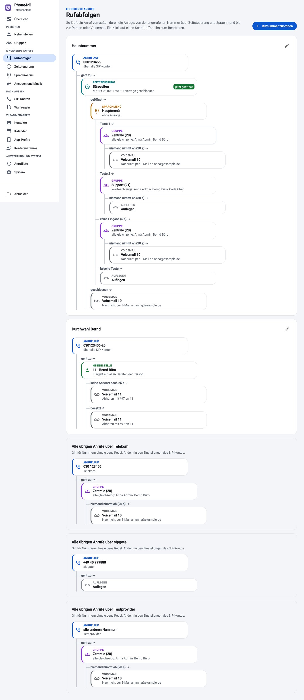
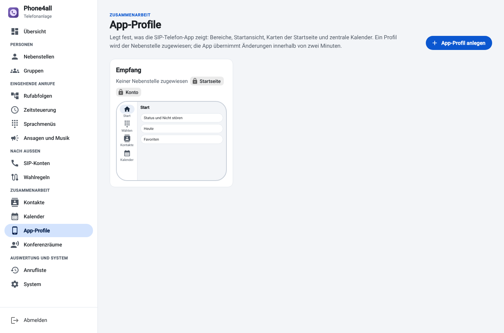
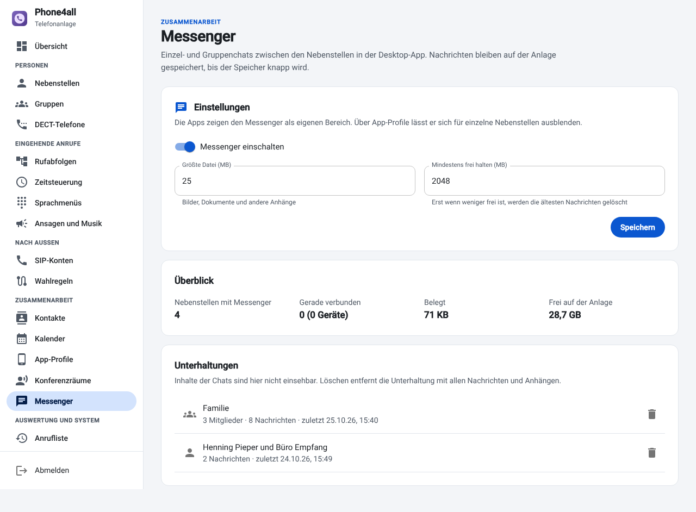

# Telefonanlage bedienen

Die Weboberfläche erreicht man unter `http://<anlage>:8080`, verschlüsselt unter
`https://<anlage>:8443` (selbst signiertes Zertifikat: einmal im Browser bestätigen). Die Navigation links ist
nach Aufgaben gruppiert: *Personen*, *Eingehende Anrufe*, *Nach außen*,
*Zusammenarbeit*, *Auswertung und System*. Jede Seite erklärt oben in einem Satz, wofür
sie da ist; Änderungen gelten sofort, ohne Neustart.

Technische Details (Ports, Schnittstellen, Datenablage) stehen in der
[Referenz](../pbx/README.md), die Installation unter [Installation](installation.md).

## Übersicht

- Kacheln für Nebenstellen online, angemeldete SIP-Konten, laufende Gespräche und
  gesperrte Adressen.
- *Erste Schritte* hakt ab, was schon eingerichtet ist, und führt zum nächsten Schritt.
- *Laufende Gespräche* mit Nebenstelle und Gegenstelle (bei Anrufen von außen die
  Nummer des Anrufers).
- *Funktionen am Telefon*: alle Funktionscodes zum Nachschlagen.

## Personen

### Nebenstellen

Jede Person bekommt eine interne Nummer. Darauf können sich mehrere Geräte gleichzeitig
anmelden: Desktop-App, Mobil-App, Tischtelefon, DECT-Mobilteil. Ein Anruf klingelt
überall.

| Einstellung | Bedeutung |
| --- | --- |
| Rufnummer nach außen | eigene Nummer, die Angerufene sehen (Auswahl aus den Nummern der SIP-Konten); bestimmt auch das SIP-Konto für ausgehende Anrufe |
| Darf anrufen | intern, Deutschland oder weltweit; Sonderrufnummern getrennt |
| Klingeldauer | danach greift *Ohne Antwort weiterleiten an* bzw. die Voicemail |
| Bei besetzt / ohne Antwort weiterleiten an | andere Nebenstelle, Gruppe, Voicemail oder externe Nummer |
| Automatisch umleiten | Regeln: *zu bestimmten Zeiten* (Wochentage, von–bis, auch über Mitternacht), *nach Zeitsteuerung* (geöffnet/geschlossen), *bei einem Termin im Kalender* (zentraler Kalender, optional nur Termine mit einem Stichwort wie „Urlaub Anna“) oder *bei „Nicht stören“*; die Regel leitet um oder schaltet *Nicht stören* ein; die erste greifende Regel gilt |
| Handy klingelt mit | Handynummer, nach wie vielen Sekunden es dazukommt und ob man mit Taste 1 annehmen muss (sonst nimmt die Mailbox des Handys jeden Anruf an); ein- und ausschalten auch in den Apps und unter `/me` |
| Türsprechstelle | die Nebenstelle ist eine Tür: Klingeln meldet die Anlage an Home Assistant (`phone4all_door_ring`) und Webhooks (`door.ring`), die Apps zeigen im Gespräch *Tür öffnen* und senden die eingetragenen Tasten (z. B. `*9`) |
| Voicemail, Voicemail-PIN | Anrufbeantworter; *Nachricht als Anhang per E-Mail* |
| Gespräche aufzeichnen | Aufnahmen erscheinen in der Anrufliste |
| App-Profil | was die Apps zeigen (siehe [App-Profile](#app-profile)) |
| Einrichtungslink, Einrichtungs-PIN, QR-Code | automatische Einrichtung der Apps; *Einladung per E-Mail* schickt beides an die Person; beides gilt 72 Stunden |
| Eingerichtete Geräte | jede App mit eigenem Zugang, zuletzt gesehen und von wo; einzeln oder alle abmelden (z. B. verlorenes Handy) |

Die Liste zeigt, welche Geräte angemeldet sind und ob *Nicht stören* oder eine
Rufumleitung aktiv ist (beides lässt sich hier auch ausschalten). Eine Sofort-Umleitung
(\*21 am Telefon oder in der Phone4All-App) geht den Regeln immer vor.

**Status aus dem Kalender:** Greift eine Kalender-Regel, sehen die Kollegen in den Apps
den Termin samt Ende neben dem Namen, z. B. „Urlaub bis 7.11.“.

### Gruppen

Mehrere Nebenstellen unter einer Nummer:

- **Alle gleichzeitig** – klassischer Sammelruf.
- **Nacheinander** – in der eingestellten Reihenfolge, je Person mit eigener Klingeldauer.
- **Warteschlange mit Wartemusik** – Verteilung an alle freien gleichzeitig, reihum
  (gleichmäßig) oder an den, der am längsten nicht telefoniert hat; mit Ansage vorher und
  maximaler Wartezeit.

*Weiter zu* legt fest, wohin der Anruf geht, wenn niemand annimmt. *Vor den Anrufernamen
setzen* zeigt am Telefon z. B. „Vertrieb: Anna Müller“, damit man weiß, über welche
Nummer der Anruf kam. \*8 holt einen klingelnden Anruf der eigenen Gruppe heran.

**An- und abmelden:** Wer gerade nicht mitklingeln soll (Pause, Außentermin), meldet sich
aus der Gruppe ab: \*45 schaltet alle eigenen Gruppen um, \*45 + Gruppennummer nur eine;
in den Apps und unter `/me` gibt es je Gruppe einen Schalter. Abgemeldete bekommen auch
keine Durchsagen an die Gruppe.

**Verpasste Anrufe gemeinsam abarbeiten:** Mit *Verpasste Anrufe als gemeinsame Liste*
sehen alle Mitglieder in den Apps dieselbe Liste. Wer zurückruft, übernimmt den Eintrag
(„Anna kümmert sich“), damit nicht drei Leute denselben Kunden anrufen. Ruft jemand die
Nummer zurück oder kommt der Anrufer später durch, hakt die Anlage den Eintrag selbst ab.

*Rechte der Mitglieder in der App* gibt allen Mitgliedern zusätzliche Rechte in der
Phone4All-App, z. B. dem Empfang das Bearbeiten des Telefonbuchs. Die Grundrechte aller
Nebenstellen stehen unter *System → Zugang*:

| Recht | erlaubt in der App |
| --- | --- |
| Umleitung schalten | Sofort-Umleitung ein/aus (auch \*21 am Telefon) |
| Nach außen umleiten | Umleitung auf externe Nummern statt nur auf Nebenstellen und Gruppen |
| Umleitungsregeln bearbeiten | Weiterleitung bei besetzt/keine Antwort und Regeln nach Zeit |
| Zentrale Kalender bearbeiten | Termine in beschreibbaren zentralen Kalendern |
| Telefonbuch bearbeiten | Einträge im zentralen Telefonbuch |
| Fremde Voicemail abhören | \*98 mit der PIN der anderen Mailbox |
| Rufnummern sperren | Anrufer aus dem Verlauf auf die Sperrliste der Anlage setzen |
| Durchsage und Gegensprechen | \*80 + Nebenstelle, \*81 + Gruppe, \*81 an alle (siehe unten) |
| Faxe senden | PDF aus der Desktop-App als Fax verschicken |

### Tischtelefone

Yealink (T3x, T4x, T5x) und Snom (D1xx, D3xx, D7xx) richten sich selbst ein: Telefon mit
Hersteller, MAC-Adresse und Nebenstelle anlegen, *Einrichten* zeigt die
Provisioning-Adresse. Die trägt man am Telefon ein (Yealink: *Einstellungen → Auto
Provision*, Snom: *Setting URL*) oder verteilt sie per DHCP-Option 66.

Das Telefon holt sich SIP-Konto, deutsche Sprache, Zeitzone, Voicemail-Taste, das
Telefonbuch (LDAP, falls eingeschaltet) und die **Funktionstasten**: Besetztanzeige mit
Heranholen (BLF), Kurzwahl, Parkplatz und *Nicht stören*. Durchsagen nimmt es von selbst
an. Optional setzt die Anlage das Passwort der Weboberfläche des Telefons.

Die Adresse ist geheim und gehört zu genau einem Telefon: Fragt ein Gerät mit anderer MAC
an, bekommt es nichts. *Neuen Link erzeugen* macht die alte Adresse ungültig. Die Liste zeigt, wann
das Telefon zuletzt abgerufen hat und ob es angemeldet ist.

### DECT-Telefone

Gigaset N610/N670/N870 IP PRO: Basis mit MAC-Adresse anlegen, Mobilteilen Nebenstellen
zuordnen, Provisioning-Adresse in der Basis eintragen. Anleitung: [DECT-Telefone](dect.md).

### Durchsage und Gegensprechen

Mit dem Recht *Durchsage und Gegensprechen* (unter *System → Zugang* oder je Gruppe):

- \*80 + Nebenstelle: **Gegensprechen**, beide hören und sprechen sofort,
- \*81 + Gruppennummer: **Durchsage** an alle angemeldeten Mitglieder (nur hören),
- \*81 allein: Durchsage an alle Nebenstellen.

Tischtelefone und die Phone4All-Apps nehmen von selbst auf dem Lautsprecher an (in den
Apps abschaltbar). Wer *Nicht stören* hat, wird ausgelassen. Anrufer von außen können sich
nicht als Durchsage ausgeben.

## Eingehende Anrufe

### Rufabfolgen

Zeigt als Diagramm, was mit einem Anruf von außen passiert: angerufene Nummer →
Zeitsteuerung → Sprachmenü → Gruppe oder Nebenstelle → Voicemail oder Auflegen.

- **Rufnummer zuordnen** legt eine Regel für eine angerufene Nummer an (Auswahl aus den
  Nummern der SIP-Konten), optional nur für Anrufer mit bestimmter Vorwahl.
- Ein Klick auf einen Schritt öffnet ihn zum Bearbeiten.
- Das Ziel jedes Zweigs (*geht zu*, *geöffnet*, *geschlossen*, *Taste 1*, *niemand nimmt
  ab* …) lässt sich direkt im Diagramm per Auswahlmenü ändern oder per **Drag & Drop**
  aus der Bausteinleiste setzen. Tasten eines Sprachmenüs werden im Diagramm hinzugefügt
  und entfernt.
- Unten stehen die Abfolgen *Alle übrigen Anrufe über …* für Nummern ohne eigene Regel;
  sie werden im jeweiligen SIP-Konto eingestellt.

### Zeitsteuerung

Öffnungszeiten je Wochentag (auch mehrere Zeitfenster), Feiertage des Bundeslandes,
zusätzliche geschlossene Tage (Betriebsferien) und eine manuelle Umschaltung. Am Telefon
schaltet \*28 + Nummer der Zeitsteuerung in den gegenteiligen Zustand (z. B. früher in die
Nachtschaltung), ein zweites \*28 kehrt zum Automatikbetrieb zurück. Das Diagramm zeigt,
ob gerade geöffnet ist.

### Sprachmenüs

„Für den Vertrieb drücken Sie die 1 …“: Ansage, Ziel je Taste, Ziel bei keiner Eingabe
und bei falscher Taste, wie oft die Ansage wiederholt wird. Auf Wunsch dürfen Anrufer
Nebenstellen direkt wählen.

### Ansagen und Musik

Ansagen hochladen (WAV, MP3, …), direkt im Browser aufnehmen oder **aus Text sprechen
lassen**, außerdem eigene Wartemusik. Ansagen werden in Sprachmenüs, Gruppen und
Rufabfolgen verwendet.

*Aus Text sprechen* nutzt [Piper](https://github.com/rhasspy/piper), das auf der Anlage
selbst läuft (auch auf dem Raspberry Pi, ohne Cloud). Programm und Stimme (Thorsten,
Kerstin oder Eva) werden beim ersten Gebrauch geladen, zusammen etwa 90 MB. Zahlen und
Uhrzeiten klingen ausgeschrieben am besten („neun bis siebzehn Uhr“).

### Anrufsperren

Gesperrte Rufnummern kommen bei niemandem mehr durch, das Telefon klingelt gar nicht erst.
Mit `*` am Ende sperrt ein Eintrag alle Nummern mit diesem Anfang (z. B. `+44*`). Anrufe
mit unterdrückter Nummer lassen sich hier ebenfalls abweisen. Sperren geht auch direkt in
der *Anrufliste* (Knopf neben dem Anruf) und in den Apps, wenn die Nebenstelle das Recht
*Rufnummern sperren* hat (*System → Zugang* oder bei der Gruppe). Gesperrte Anrufe stehen
in der Anrufliste als *Gesperrt*.

## Nach außen

### SIP-Konten

Die Verbindungen ins Telefonnetz. Jede Karte zeigt Anmeldestatus, Rufnummern und wohin
Anrufe gehen.

Vorlagen: Telekom (IP-Anschluss und CompanyFlex/DeutschlandLAN SIP-Trunk), Vodafone Kabel,
Vodafone DSL/Glasfaser, Deutsche Glasfaser, 1&1, o2/Telefónica, sipgate basic/team,
sipgate trunking, easybell, Placetel, FRITZ!Box (als vorgeschaltete Anlage) und *Anderer
Anbieter*. Unter *Erweitert*: Transport, Codecs, SRTP, Nummernformat, From-Benutzer/-Domain,
*Nur IP-Prüfung* für feste SIP-Trunks, Anzahl gleichzeitiger Gespräche und die Anzeige der
Anrufernummer bei Weiterleitungen (CLIP no screening).

Anrufe auf eine eigene Nummer, die zu einem anderen SIP-Konto gehört, stellt die Anlage
intern durch, statt sie übers Telefonnetz zu schicken.

### Wahlregeln

Welche ausgehenden Anrufe über welches SIP-Konto gehen, z. B. Mobilfunknummern über
Konto A, alles andere über Konto B. Die Regeln gelten von oben nach unten; fällt ein
Konto aus, nimmt die Anlage das nächste der Kette. Regeln können auf einzelne
Nebenstellen beschränkt werden. Ohne Regeln telefoniert jede Nebenstelle über das Konto
ihrer *Rufnummer nach außen*.

## Zusammenarbeit

### Kontakte

Das zentrale Telefonbuch (auch CSV-Import). Die Anlage zeigt damit bei Anrufen den Namen,
alle Apps übernehmen die Kontakte innerhalb von zwei Minuten. Darunter lässt sich das
**Telefonbuch per LDAP** für DECT- und Tischtelefone einschalten (Werte siehe
[Referenz](../pbx/README.md#telefonbuch-per-ldap)).

**Externe Kontaktquellen** liest die Anlage regelmäßig (nur lesen) und gibt sie wie das
eigene Telefonbuch weiter: an alle Apps, an DECT- und Tischtelefone (LDAP) und als Name bei
eingehenden Anrufen.

| Art | Angaben |
| --- | --- |
| CardDAV | Adresse des Servers, Kontos oder Adressbuchs (Nextcloud, iCloud, mailbox.org …), Benutzer, (App-)Passwort; alle Adressbücher des Kontos werden gelesen |
| vCard- oder CSV-Datei | Adresse einer `.vcf`/`.csv`-Datei, z. B. Export-Link eines CRM; optional mit Anmeldung |
| Microsoft SQL Server | Server (auch `server\instanz`), Port, Datenbank, Benutzer (auch `DOMÄNE\benutzer`); Tabelle/Sicht mit Namens-, Firmen- und Telefonspalten oder eine eigene `SELECT`-Abfrage |

Die Liste zeigt je Quelle, wann sie zuletzt gelesen wurde, wie viele Kontakte sie liefert
oder warum das Lesen fehlschlug. Bei einem Fehler bleiben die zuletzt gelesenen Kontakte
erhalten.

### Kalender

Gemeinsame Kalender für alle Apps: *Eigene Termine* (z. B. Betriebsferien, Schichtplan),
*Feiertage des Bundeslandes (automatisch)* oder *Anderer Kalender* – ein Kalender-Abo
(ICS/webcal-Link aus Google, Outlook/Exchange, Nextcloud …) oder ein CalDAV-Kalender, den
die Anlage regelmäßig liest (nur lesen, zwei Monate zurück bis gut ein Jahr voraus). Bei
eigenen Terminen ist einstellbar, ob alle eintragen dürfen oder nur hier geändert wird. Welche Kalender eine App zeigt, legt das
App-Profil fest.

### App-Profile

Ein App-Profil legt fest, was Desktop- und Mobil-App zeigen:

- welche Bereiche (Start, Wählen, Kontakte, Kalender, Verlauf, Messenger) in welcher Reihenfolge –
  per Drag & Drop sortierbar,
- mit welcher Ansicht die App startet,
- welche Karten auf der Startseite liegen (ebenfalls per Drag & Drop),
- welche zentralen Kalender erscheinen,
- ob Startseite und Kontodaten in der App gesperrt sind,
- ob die App Anrufer im **CRM** öffnet: Adresse mit den Platzhaltern `{nummer}`,
  `{e164}` und `{name}`, z. B. `https://crm.example.de/suche?telefon={e164}`. Die App
  zeigt dann im Gespräch einen Knopf *CRM*; auf Wunsch öffnet sie die Seite beim
  Annehmen von selbst.

Die Vorschau zeigt, wie die App aussieht. Zugewiesen wird das Profil bei der Nebenstelle;
die Apps übernehmen Änderungen innerhalb von zwei Minuten.

### Fax

Faxe ohne Faxgerät: Ein *Fax* (Name, E-Mail-Adressen, Kennung, Kopfzeile, Absendernummer)
ist Ziel in einer Rufabfolge. Empfangene Faxe kommen als PDF per E-Mail und stehen in der
Liste darunter. Gesendet wird ein PDF über *Fax senden* oder aus der Desktop-App (Recht
*Faxe senden*); die Anlage versucht es bis zu dreimal und schickt einen Sendebericht per
E-Mail. Für SIP-Konten, die T.38 können, lässt sich das beim Konto einschalten; sonst geht
das Fax als Ton über G.711. Faxe werden 30 Tage aufbewahrt.

### Konferenzräume

Telefonkonferenzen mit beliebig vielen Teilnehmern, optional mit PIN. Intern über die
Nummer des Raums erreichbar, von außen, wenn der Raum Ziel einer Rufabfolge ist.

### Messenger

Chats zwischen den Nebenstellen in der Desktop-App. Hier wird der Messenger ein- und
ausgeschaltet, die größte Datei festgelegt und wie viel Speicher frei bleiben soll.
Nachrichten werden nicht nach Zeit gelöscht: Erst wenn auf der Anlage weniger frei ist als
eingestellt, verschwinden die ältesten Nachrichten samt Anhängen (vermerkt unter
*System → Diagnose*). Die Liste zeigt alle Unterhaltungen mit Mitgliedern und Anzahl der
Nachrichten, aber keine Inhalte; einzelne Unterhaltungen lassen sich löschen.

Wer den Messenger nutzen darf, steuern die App-Profile: Nebenstellen mit einem Profil ohne
den Bereich *Messenger* sind nicht dabei. Nebenstellen ohne Profil sehen ihn immer.

**Videoanrufe in den Chats** (eingeschaltet, solange der Messenger an ist): Jeder Chat hat
einen eigenen Konferenzraum, in den die Desktop-App per WebRTC (VP8 und Opus) wählt. Die
Anlage leitet jedes Bild einzeln an die anderen weiter, statt es neu zu mischen; das
schont den Prozessor, braucht aber je Teilnehmer Bandbreite für alle Bilder. Die Apps
melden sich dafür als eigenes Gerät `<nummer>-video` an, das nur Chat-Räume anrufen kann,
in denen die Nebenstelle Mitglied ist. Der Überblick zeigt, wie viele Videoanrufe gerade
laufen. Für Anrufe von unterwegs gelten dieselben Voraussetzungen wie für die Mobil-App
(*System → Fernzugriff*).

## Auswertung und System

### Anrufliste

Alle Gespräche, neueste zuerst: eingehend, ausgehend, intern, mit Dauer. Aufnahmen
lassen sich hier anhören, lästige Anrufer mit einem Klick sperren.

### Auswertungen

Für einen Zeitraum (7 Tage, 30 Tage, ein Jahr oder frei gewählt): Anrufe von außen,
angenommen, nicht angenommen und wie viele davon auf der Voicemail landeten, mittlere
Gesprächsdauer; Anrufe je Uhrzeit und Wochentag, je angerufener Nummer, je Nebenstelle
und Wartezeiten der Warteschlangen. Die Diagramme gibt es auch als Tabelle, alles als CSV.

### Voicemail als Text

Unter *System → Funktionen*: Neue Nachrichten schreibt die Anlage als Text mit. Der Text
steht in den Apps, unter `/me`, im Webhook `voicemail.transcribed` und – statt der
bisherigen Mail von Asterisk – in der Voicemail-Mail samt Aufnahme.

- **Auf der Anlage** (whisper.cpp, nichts verlässt das Haus): Modell wählen und laden.
  *Klein* (rund 190 MB) ist der gute Mittelweg, *Groß* genauer, aber deutlich langsamer;
  auf einem Raspberry Pi dauert das Umwandeln spürbar länger als auf einem PC.
- **Über einen Dienst** mit OpenAI-kompatibler Schnittstelle (OpenAI, Groq, ein eigener
  Whisper-Server …): Adresse, Schlüssel, Modell. Die Aufnahme geht dafür an diesen Dienst.

*Probe* spricht einen Satz über die Sprachausgabe und zeigt, was erkannt wurde.

### System

Geänderte Einstellungen werden erst mit *Anwenden* in der Leiste am unteren Rand
übernommen; *Verwerfen* stellt den gespeicherten Stand wieder her.

| Reiter | Inhalt |
| --- | --- |
| Allgemein | Name, Adresse für Telefone, Länder-/Ortsvorwahl, Bundesland, Zeitzone, Ports, öffentliche Adresse (NAT), lokale Netze, verschlüsselte Sprache (SRTP; sinnvoll nur mit SIP über TLS am Telefon), Codecs |
| Funktionen | Gespräche parken, Benachrichtigung bei Notrufen, Voicemail als Text (siehe oben und unten) |
| E-Mail | SMTP-Server für Voicemail und Einladungen, Testmail |
| Sicherheit | Sperre nach Fehlanmeldungen, nie sperren, Nebenstellen nur aus bestimmten Netzen, gesperrte Adressen |
| Sicherung | Export (mit Passwörtern nur verschlüsselt, mit eigenem Passwort), Import, automatische Sicherungen wiederherstellen, tägliche Sicherung auf WebDAV (Nextcloud, NAS) oder S3, auf Wunsch verschlüsselt |
| Aktualisierung | neue Version installieren, Kanal stabil/Beta, automatisch nachts |
| Zugang | weitere Zugänge mit Rollen, Selbstbedienung, Passwort, Suche der App im lokalen Netz, Rechte aller Nebenstellen in der App (siehe unten) |
| Fernzugriff | öffentliche HTTPS-Adresse für Mobil-App und Einrichtungslinks ([Anleitung](fernzugriff.md)) |
| Diagnose | Zustand, Watchdog-Einstellungen, Ereignisprotokoll |
| Schnittstellen | Home Assistant und Zugriffsschlüssel ([Anleitung](home-assistant.md)), Anrufe über die Schnittstelle auslösen, Webhooks |
| Protokoll | Warnungen und Fehler von Asterisk, Neustart der Anlage |

### Zugänge und Selbstbedienung

Unter *System → Zugang* bekommen weitere Personen eine eigene Anmeldung (Anmeldename und
Passwort, mindestens 10 Zeichen):

| Rolle | darf |
| --- | --- |
| Verwaltung | alles |
| Personen und Anrufe | Nebenstellen, Gruppen, Tisch- und DECT-Telefone, Kontakte, Sperren, Konferenzen, Fax, Anrufliste und Auswertungen; nicht Rufabfolgen, SIP-Konten und System |
| Nur ansehen | alles ansehen, nichts ändern; Passwörter und Einrichtungslinks bleiben verborgen |

Der eingebaute Zugang heißt `admin`. Jede Änderung steht mit dem Anmeldenamen im
Änderungsprotokoll; jede Person ändert ihr Passwort selbst über das Menü links unten.

**Selbstbedienung** (`/me`): Jede Person meldet sich mit Nebenstelle und Voicemail-PIN an
und stellt selbst ein: Umleitung, *Nicht stören*, Handy klingelt mit, Gruppen an/ab,
Voicemail abhören und löschen, PIN ändern. Standardmäßig nur aus den lokalen Netzen
erreichbar; nach fünf falschen PINs ist die Nebenstelle 15 Minuten gesperrt.

### Gespräche parken

Ein Gespräch an die Parknummer (Standard `700`) weiterleiten legt es auf den nächsten
freien Parkplatz (`701` bis `708`). Wer den Parkplatz wählt, übernimmt das Gespräch.
Holt es niemand ab, klingelt es nach der eingestellten Zeit wieder bei dem, der geparkt hat.
Desktop- und Mobil-App haben dafür einen Knopf *Parken* im Gespräch und zeigen geparkte
Gespräche auf der Karte *Kollegen*. Abschaltbar unter *System → Funktionen*; überschneidet
sich die Parknummer bei einem Update mit vorhandenen Nummern, bleibt Parken aus.

### Benachrichtigung bei Notrufen

Wählt jemand 110 oder 112, erfahren es die eingetragenen Personen sofort per E-Mail und
Messenger, außerdem Home Assistant (`phone4all_emergency_call`) und Webhooks. Am Notruf
selbst ändert sich nichts. Gemeldet wird auch, wenn der Notruf nicht rausging (z. B. kein
SIP-Konto angemeldet).

### Webhooks und Anruf-Schnittstelle

Unter *System → Schnittstellen*:

- **Webhooks** schicken Ereignisse als JSON per POST an eine Adresse: `call.ringing`,
  `call.answered`, `call.ended`, `call.missed`, `voicemail.new`, `voicemail.transcribed`,
  `call.blocked`, `emergency`, `door.ring`. Die Kopfzeile `X-Phone4all-Signature: sha256=…` ist ein HMAC-SHA256 über
  den Body mit dem Schlüssel des Webhooks – so prüft der Empfänger die Herkunft.
- **Anrufe über die Schnittstelle**: `POST /api/integration/call` mit dem Zugriffsschlüssel
  und `{"extension":"10","number":"030123456"}`. Erst klingelt die Nebenstelle, nach dem
  Abheben wählt die Anlage die Nummer.

## Funktionscodes am Telefon

| Code | Funktion |
| --- | --- |
| \*97 | eigene Voicemail abhören |
| \*98 | andere Voicemail abhören |
| \*76 | Nicht stören ein/aus |
| \*21 + Nummer | alle Anrufe weiterleiten (\*21 allein: aus) |
| \*8 | Anruf in der eigenen Gruppe heranholen |
| \*45 | aus allen eigenen Gruppen ab- bzw. wieder anmelden; \*45 + Gruppe nur diese |
| \*80 + Nebenstelle | Gegensprechen |
| \*81 + Gruppe | Durchsage an die Gruppe; \*81 allein an alle |
| 700 (weiterleiten) | Gespräch parken; 701–708 übernimmt es |
| \*\* + Nebenstelle | Anruf einer Nebenstelle heranholen |
| \*31 + Nummer | anonym anrufen |
| \*28 + Nummer | Zeitsteuerung umschalten (Nachtschaltung) |
| \*43 | Echo-Test (Mikrofon prüfen) |
